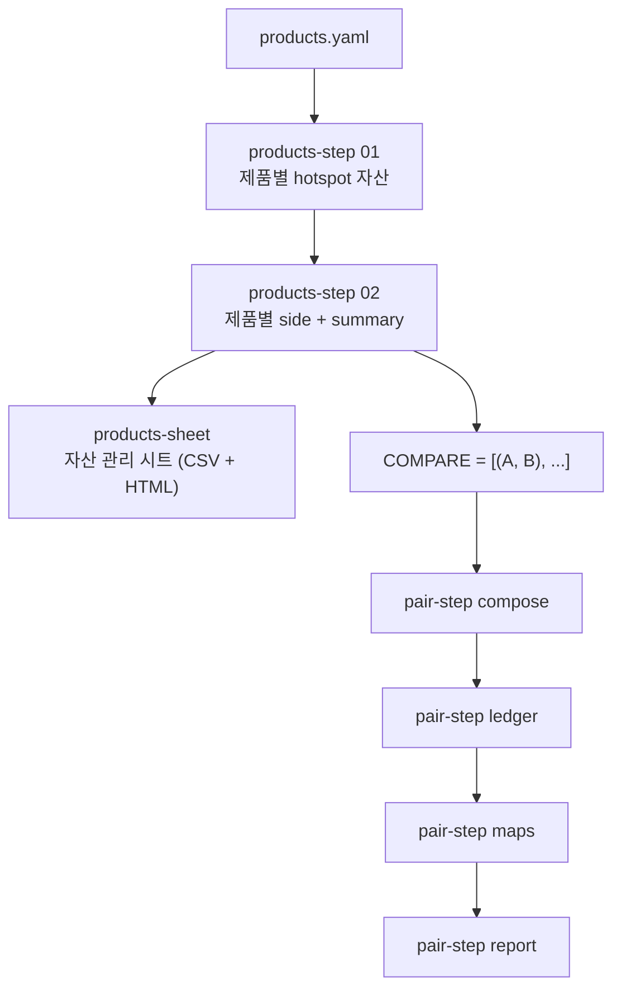

# 제품 자산 관리 (제품 모드)

이 문서는 제품 모드(`MODE = "products"`)의 설정, 실행, 점검, 정리 방법을 설명한다.
이름·오류 코드·이유 코드는 코드의 문자열 그대로 쓴다. `tests/test_product_assets_doc.py` 가 문서와 코드를 대조한다.

## 목차

1. 한 장 요약
2. 처음 설정
3. 실행기 사용 (EDIT 블록)
4. 자산 관리 시트
5. 낡은 이유 코드와 다시 돌릴 단계
6. 제품 추가·삭제·이름 바꾸기·그룹 변경
7. 결과의 의미 (중요)
8. 폴더·세대·정리
9. 주의·한계
10. ETX 첫 실행 확인 목록
11. 옛 방식과 함께 쓰기

## 1. 한 장 요약

### 무엇이 바뀌었나

- 단계 01(hotspot import)과 02(side·summary)는 **제품 하나**의 자산을 만든다. 쌍과 무관하다.
- 단계 08(장부·지도·보고서)은 **쌍 선택**(`COMPARE`)으로 돌린다. 쌍은 같은 그룹 제품끼리만 만든다.
- 제품은 `products.yaml` 에 한 번 등록한다. 자산은 낡았을 때만 다시 만든다.
- 자산 상태는 시트(`products-sheet`)로 한눈에 본다.

### 흐름



텍스트 흐름도:

```text
products.yaml
  └─ products-step 01 (제품마다) → products-step 02 (제품마다) → products-sheet
COMPARE 의 쌍마다: pair-step compose → ledger → maps → report
```

실행기 단계 이름표: `P01` = hotspot 자산, `P02` = side 자산, `C02` = 조합(compose), `C08` = 장부·지도·보고서.
실행기는 본 job 이 끝나면 항상 `products-sheet` 를 한 번 더 돌린다(실패해도 경고만 남긴다).
시트도 `RECORD_MAPS` 를 따른다. `RECORD_MAPS = False` 면 마무리 job 에 `--no-record-maps` 가 붙어, 녹화가 없는 side 를 `낡음` 으로 보지 않는다.

## 2. 처음 설정

### 2.1 기존 설정에서 products.yaml 만들기

기존 `real.yaml`, `compare2.yaml` 이 이미 자동화로 돌고 있으면 두 제품을 한 번에 넣는다.
**권장: 실행기 EDIT 의 `PRODUCTS_IMPORT` 로 돌린다**(3.1). ETX 실행기는 명령 인자를 넘기지 못하고 로컬 PC 에는 패키지를 설치하지 않기 때문이다. 실행기는 계획을 세우기 전에 항목마다 같은 `products-import` 를 돌린다. `DRY_RUN = True` 이면 `--check` 로만 돌려 결과를 보여 준다.
패키지가 설치된 PC 에서는 아래 명령으로도 된다.

```text
python -m simcompare products-import --real real.yaml --compare2 compare2.yaml --group QA4 --config products.yaml --check
python -m simcompare products-import --real real.yaml --compare2 compare2.yaml --group QA4 --config products.yaml
```

- `--check` 는 아무것도 쓰지 않는다. 결과(`would_write` 등)만 본다.
- `--no-cno` 는 두 제품의 `include_cno` 를 false 로 한다. 기본은 true 다.
- 같은 제품이 이미 있고 값이 다르면 `products_import_conflict`(종료 2)로 멈추고 다른 칸을 한 줄씩 보여 준다. 덮어쓰려면 `--update` 를 붙인다.
- `--update` 로 `common` 값이 바뀌면 products.yaml 의 모든 제품이 영향받는다. 명령이 제품 목록을 경고로 알려 준다.
- 사람이 쓴 `note` 는 `--update` 에서도 남는다. 주석은 남지 않는다(첫 줄에 이 명령이 고친 파일이라고 적힌다).
- 두 제품이 다른 그룹에 이미 있으면 `products_import_group_conflict` 로 멈춘다. 손으로 옮긴다.
- 그룹 호환 검사에 실패하면 `group_incompatible` 로 멈추고 products.yaml 은 그대로다.
- 그 밖의 입력 오류 코드: `products_import_invalid`, `products_import_unreadable`, `products_import_config_mismatch`, `products_import_io`.

손으로 쓰려면 `configs/etx/templates/products.yaml` 을 복사해 고친다. 검증만 하려면 다음을 쓴다.

```text
python -m simcompare products-config --config products.yaml --check
```

### 2.2 경로 규칙

- 입력 경로는 모두 `products.yaml` 이 있는 폴더(BASE_DIR) 기준 **상대 경로**다.
- 절대 경로, `..`, 역슬래시는 거부한다.
- 입력은 출력 루트(`data/products`, `data/compare`, `data/_runs`) 안이나 위에 둘 수 없다. 위반하면 `input_path_overlaps_output`.
- 출력 경로의 기존 폴더가 심볼릭 링크면 `output_path_symlink`.

### 2.3 이름 규칙

- 제품·그룹 이름: 영문으로 시작, 영문·숫자·`_`·`-` 만, 64 자 이하.
- 이름에 `__` 를 쓰지 않는다(쌍 이름 `<A>__<B>` 에 예약됨).
- Windows 예약 이름(CON, PRN, AUX, NUL, COM1~9, LPT1~9)을 쓰지 않는다.
- 대소문자만 다른 이름은 같은 이름으로 본다. 위반 코드: `invalid_product_name`, `invalid_group_name`, `duplicate_product_name`, `duplicate_group_name`.

### 2.4 그룹 규칙

- 제품은 그룹 하나에만 속한다. 위반 코드: `product_without_group`, `product_in_two_groups`, `unknown_product_in_group`.
- 쌍은 같은 그룹의 서로 다른 제품이어야 한다. 위반 코드: `compare_cross_group`, `pair_same_product`, `pair_unknown_product`.
- 그룹의 모든 제품은 **같은 pairs.csv 내용**(sha256 같음)을 쓴다.
- 그룹의 기대 case 는 제품들의 short case 이름 합집합이다(`data/products/_groups/<그룹>/expected_cases.txt`).
- 호환 검사는 이름만 본다(마스크·PNG 는 읽지 않는다). 최종 판정은 02 의 로더가 한다.
- 위반하면 `group_incompatible` 로 멈추고, 아래 코드와 (제품, case) 쌍을 한꺼번에 보여 준다.

| 코드 | 뜻 |
|---|---|
| `group_pair_table_mismatch` | 그룹 제품의 pairs.csv 내용이 다르다 |
| `group_case_layer_unassigned` | case 이름의 층이 그 제품의 `layer_stack` 에 없다 |
| `group_case_layer_mismatch` | vertical 이 아닌 case 인데 두 층이 다르다 |
| `group_case_vertical_same_layer` | vertical_short case 인데 두 층이 같다 |
| `group_case_density_layer_missing` | 분석 층의 `density_process_layer` 가 비었거나 밀도 파일에 없다 |
| `group_case_pair_unmapped` | case 의 전극 쌍이 pairs.csv 에 없다 |
| `group_distance_table_required` | vertical case 가 있는데 `interlayer_distance_path` 가 없다 |
| `group_distance_pair_missing` | 제품 자기 폴더에 있는 vertical case 의 층 쌍이 거리표에 없다 |
| `group_cno_layer_unassigned` | CNO 폴더 이름의 층을 해석하지 못하거나 `layer_stack` 에 없다(`include_cno` 켠 제품) |
| `group_cno_density_layer_missing` | CNO 층의 `density_process_layer` 가 비었다 |

같은 전극 이름 case(A/A)는 pairs.csv 에 들어갈 수 없다. 이 case 는 층, 방향, 밀도 층만 검사한다.

### 2.5 그 밖의 products.yaml 오류 코드

`invalid_products_config`(모르는 키·형식 오류), `unsupported_products_config`(`schema_version` 이 `simcompare_products_v1` 이 아님), `hotspot_root_missing`, `pair_table_missing`, `data_dir_missing`, `gen_file_not_owned`.

- 모르는 키는 거부한다. `note` 만 자유 문자열이다.
- `gen.*.yaml` 은 첫 줄 표지가 있을 때만 다시 쓴다. 표지가 없는 같은 이름 파일은 `gen_file_not_owned` 로 거부한다. 손으로 고치지 않는다.

## 3. 실행기 사용 (EDIT 블록)

### 3.1 제품 모드 켜기

실행기 파일은 `bundles/etx/simcompare_job_etx.py`(ETX)와 `bundles/local/simcompare_job_local.py`(로컬 PC)다. 파일 하나를 작업 폴더(BASE_DIR)에 복사해 쓴다. 공통 사용법은 [usage.md](usage.md)의 "제품 모드" 절을 본다.
EDIT 블록에서 `MODE = "products"` 로 바꾼다(기본은 `"pair"`). 제품 값 원문은 다음과 같다.

```python
PRODUCTS_CONFIG = "products.yaml"
PRODUCTS = None                     # 자산을 만들 제품. None = 등록 전체
ASSET_STEPS = ["01", "02"]          # [] = 자산을 만들지 않음
COMPARE = []                        # [("A", "B"), ...] (기준, 대상), 같은 그룹만
COMPARE_STEPS = ["02", "08"]        # 02 = 조합, 08 = ledger·지도·보고서
FORCE_ASSETS = []                   # 신선해도 다시 만들 제품
PRODUCTS_IMPORT = []                # [("real.yaml", "compare2.yaml", "QA4"), ...] = 실행 전에 이 설정의 두 제품을 products.yaml 에 넣는다
PRODUCTS_IMPORT_UPDATE = False      # True = 이미 등록된 제품·공통 값이 다르면 덮어쓴다(note 유지)
RECORD_MAPS = True                  # 02: side 를 만들 때 08 지도용 원자료도 녹화
MAPS_SRC_MAX_BYTES = 32 * 1024**3   # 02: 녹화 크기 상한(비압축 합, 기본 32 GiB)
```

- `PRODUCTS`: 자산을 만들 제품. `None` 이면 등록 전체. 등록에 없는 이름은 `etx_product_unknown`.
- `ASSET_STEPS`: 순서는 고정이다(제품마다 01 → 제품마다 02). 모르는 값은 `etx_asset_steps_invalid`.
- `COMPARE_STEPS`: `"02"` 는 쌍마다 compose, `"08"` 은 쌍마다 ledger → maps → report. 모르는 값은 `etx_compare_steps_invalid`.
- `COMPARE`: (기준, 대상) 쌍 목록. A 가 reference, B 가 target 이다. 오류: `etx_compare_same_product`, `etx_compare_cross_group`, `etx_product_unknown`, `etx_setting_invalid`(같은 쌍 중복 등).
- `FORCE_ASSETS`: 그 제품의 `ASSET_STEPS` 에 든 단계만 신선해도 다시 만든다(`["02"]` 이면 02 만). `PRODUCTS` 에 없거나 `ASSET_STEPS` 가 비면 `etx_force_not_selected`.
- `PRODUCTS_IMPORT`: (real.yaml, compare2.yaml, 그룹) 세 문자열 항목 목록. 제품 모드에서만 읽는다(pair 모드는 무시). 실행기는 **계획(products.yaml 적재·검증)보다 먼저** 항목을 차례로 `products-import` 로 처리하고(`--config` = `PRODUCTS_CONFIG`, `--update` = `PRODUCTS_IMPORT_UPDATE`) 항목마다 `added`/`updated`/`unchanged` 한 줄을 로그에 찍는다. 공통 값이 바뀌면 영향받는 제품 목록도 찍는다. 하나라도 실패하면(`products_import_conflict`, `products_import_group_conflict`, `group_incompatible`, 파일 없음 `products_import_unreadable` 등) import 의 오류 코드 그대로 종료 2 로 멈추고 job 은 하나도 돌지 않는다. products.yaml 은 그대로다. 항목 모양이 틀리면 `etx_setting_invalid`.
- `PRODUCTS_IMPORT_UPDATE`: `True` 면 이미 등록된 제품·공통 값이 달라도 덮어쓴다(사람이 쓴 `note` 는 남는다). 공통 값이 바뀌면 모든 제품이 영향받는다. 기본 `False` 는 다른 값을 `products_import_conflict` 로 멈춘다.
- `DRY_RUN = True` 일 때 import 는 `--check` 로만 돌아 아무것도 쓰지 않는다. products.yaml 이 아직 없으면 계획을 세울 수 없어 "계획 생략" 한 줄만 찍고 끝난다. 있으면 기존 파일로 계획을 찍는다.
- `LEDGER_MAPS_CARDS`: `None` = 모드 기본(제품 모드는 카드 끔), `False` = `--no-cards`, `True` = `--cards`.
- `RECORD_MAPS`: 02 에서 지도 원자료를 녹화한다. 끄면 `products-step 02` 에 `--no-record-maps` 가 붙는다.
- `MAPS_SRC_MAX_BYTES`: `RECORD_MAPS` 가 켜져 있고 값이 기본값이 아닐 때만 `--maps-src-max-bytes` 가 붙는다. 양의 정수여야 한다(`etx_setting_invalid`).
- `RUN_TAG`: 옛 세대를 옮길 폴더 이름(`data/_runs/<RUN_TAG>`). `None` 이면 UTC 시각. 이름 규칙 위반은 `etx_run_tag_invalid`.
- `MODE` 가 `"pair"`, `"products"` 가 아니면 `etx_mode_invalid`. 할 일이 없으면 `etx_no_jobs`.

### 3.2 제품 모드에서 읽지 않는 값

EDIT 블록 원문: "제품 모드는 아래 제품 값과 `LEDGER_MAPS_CARDS`·`RUN_TAG`·`DRY_RUN`·`LOG_FILE`·`WORK_DIR` 만 읽는다."
따라서 `STEPS`, `REAL_CONFIG`, `COMPARE2_CONFIG`, `INCLUDE_CNO`(제품마다 `products.yaml` 의 `include_cno` 가 대신한다), `LEDGER_DIR`, `LEDGER_MAPS_DIR`, `LEDGER_REPORT_DIR`, `LEDGER_MAPS`, `LEDGER_MAPS_ARGS` 와 선택 단계(03~07) 값은 제품 모드에서 쓰지 않는다.
제품 모드는 실행기가 출력 폴더를 옮기지 않는다. `products-step` 과 `pair-step` 이 자기 세대를 판단하고 보관한다.

### 3.3 예시 세 가지

**(가) 자산만 미리 만들기** (비교는 하지 않음)

```python
MODE = "products"
ASSET_STEPS = ["01", "02"]
COMPARE = []
```

**(나) 비교만** (자산은 이미 `정상` 이어야 한다)

```python
MODE = "products"
ASSET_STEPS = []
COMPARE = [("QA4_R00", "QA4_T00")]
COMPARE_STEPS = ["02", "08"]
```

자산이 `없음` 이면 `asset_missing`, `낡음` 이면 `asset_stale` 로 멈춘다(제품·이유 코드가 함께 나온다).

**(다) 08 만 다시**

```python
MODE = "products"
ASSET_STEPS = []
COMPARE = [("QA4_R00", "QA4_T00")]
COMPARE_STEPS = ["08"]
```

조합(02)이 낡았으면 `pair_compose_stale` 로 거부된다. 이유 코드가 함께 나온다. 조합이 낡았는지 확신이 없으면 `["02", "08"]` 을 쓴다(조합이 신선하면 `skip fresh compose` 로 건너뛴다).
08 은 ledger, maps, report 세 단계를 모두 다시 만든다. 중간부터 이어 하는 방법은 없다.

### 3.4 DRY_RUN 출력 읽는 법

`DRY_RUN = True` 로 먼저 돌려 계획을 본다. 아무것도 만들거나 옮기지 않는다. 로그의 각 줄은 `[simcompare_job]` 로 시작한다.

```text
flow: mode products; <products.yaml>; products ...; asset steps ...; compare A->B; compare steps ...; run tag ...
flow: N job(s):
  job [P01] products-step --config ... --product ... --step 01 --run-tag ...
  job [C02] pair-step ... --step compose ...
  job [C08] pair-step ... --step ledger|maps|report ...
  finalizer products-sheet --config ...
flow: asset state of products.yaml (read only):
  asset <제품>: 정상
  asset <제품>: 낡음 [이유 코드, ...]
  pair <A>__<B> compose: 정상(건너뜀) | 다시 만듦 [이유 코드, ...] | 판정 불가 ...
flow: DRY_RUN = True: nothing was run or moved
```

- `asset ...: 판정 실패` 는 그 제품의 판정 자체가 실패했다는 뜻이다. 줄의 예외 이름을 본다.
- `pair ... compose: 판정 불가` 는 두 제품 중 하나가 `정상` 이 아니라서 조합을 판정하지 못했다는 뜻이다.
- 각 명령의 종료 코드: 0 = 만듦·건너뜀, 2 = 오류·거부, 3 = 부분 결과(`products-step` 은 부분 summary).

## 4. 자산 관리 시트

### 4.1 파일

- `data/products/products_sheet.csv` (UTF-8 BOM, Excel 로 열림)
- `data/products/products_sheet.html` (같은 표, 긴 목록을 펼쳐 보여 준다, 외부 자원 없음)

실행기가 매번 끝에 `products-sheet` 를 돌린다. 손으로는 `python -m simcompare products-sheet --config products.yaml` 로 돌린다.
시트는 **읽기 전용 판정**이다. 자산·설정·폴더를 만들거나 고치지 않는다. 시트 두 파일만 쓴다.

### 4.2 줄

- 등록된 제품마다 한 줄.
- `data/products/<P>/` 폴더가 남아 있는데 `products.yaml` 에서 빠진 제품은 `등록 없음` 줄.
- 01 만 만든 제품은 한 줄이고 02 칸은 비며 상태는 `없음`.

### 4.3 열 묶음

앞의 아홉 열(`요약`)은 항상 보인다. 제품 열은 가로로 밀어도 왼쪽에 고정된다. 나머지 묶음은 HTML 에서 처음에 접혀 있고, 묶음 머리를 눌러 펼친다. CSV 에는 모든 열이 같은 순서로 들어 있다.

| 묶음 | 내용 |
|---|---|
| 요약 | 제품, 그룹, 자산 상태, 이유 코드, vi_line, vi_pixel, 마지막 실행, 쌍(마지막 08), note |
| 식별 상세 | product_id, 제품군, 해상도, unit 크기 |
| 입력 위치 | hotspot 폴더, DL1 모델, pairs.csv, 거리표 |
| 층 | 층 수, 층 이름(stack_order 순) |
| case | short·CNO·제외 case 수, line·pixel 조건 수, 기대 case 수, absent case 수, 그룹 합집합 |
| 크기 | 관측 지름 최소·최대·수 |
| 지표 상세 | caa_line, caa_pixel, λ line·pixel·cno (vi 는 요약에 있다) |
| 밀도 | 밀도 line·pixel 해시, 지름 부분집합 |
| DL1 | DL1 전극 수 |
| 자산 | 01·02 만든 시각과 소요(s), manifest·input·code 해시, side_basis |
| 세부 상태 | 01·side·summary 상태, 지표 상태, 지도 원자료 상태, 자산 폴더(MB) |

해시 칸은 `sha256:` 뒤에 앞 12 자리만 보인다. HTML 은 칸에 마우스를 올리면 전체 값을 보여 준다.

### 4.4 상태 값

| 값 | 뜻 |
|---|---|
| `정상` | 자산이 현재 설정·입력·코드와 맞다 |
| `낡음` | 만들어졌지만 이유 코드가 하나 이상 있다 (5절) |
| `없음` | 아직 만들지 않았다 |
| `손상` | 파일이 깨졌거나 사라졌다 (`asset_corrupt:<이유>`) |
| `등록 없음` | 폴더만 남고 `products.yaml` 에 없다 |
| `판정 실패` | 판정 중 예외가 났다. 이유 칸에 예외 코드나 이름이 있다 |

자산 상태는 hotspots(01), side, summary 세 자산 중 가장 나쁜 값이다(`손상` > `없음` > `낡음` > `정상`).

시트는 그룹마다 따로 판정한다. 한 그룹이 호환 규칙을 어기면 그 그룹 제품만 `판정 실패` 가 되고, 다른 그룹 제품은 `정상` 으로 보일 수 있다. 그래도 실행기는 `products.yaml` 의 모든 그룹을 먼저 검사한다. 그래서 위반 그룹을 고치기 전에는 어느 제품의 01·02 도 돌지 않는다. 위반 내용은 시트 머리말의 "그룹 호환 위반" 줄에 있다.

### 4.5 마지막 실행, 지표 상태, 지도 원자료 상태

- **마지막 실행**: `asset_log.jsonl` 의 마지막 줄. `성공 <단계> <시각>` 또는 `실패 <단계> <시각> (<오류 코드>)`. 반쯤 쓰인 마지막 줄은 건너뛴다.
- **지표 상태**: summary 의 상태(`available`, `partial` 등). summary 가 없으면 `없음`, 읽지 못하면 `손상`.
- **지도 원자료 상태**: side 의 `maps_src` 상태. `complete`(08 이 재생), `failed`(녹화 실패, 08 은 직접 계산), `none`(녹화 없음).

### 4.6 CSV 와 HTML 의 관계

- 두 파일은 같은 `sheet_id` 를 가진다(표 내용의 해시, 갱신 시각은 포함하지 않는다).
- 기준 표시는 HTML 이다. CSV 는 같은 `sheet_id` 의 표다.
- 두 파일의 `sheet_id` 가 다르면 갱신이 중간에 멈춘 것이다. `products-sheet` 를 다시 돌린다.
- CSV 의 텍스트 칸이 `=`, `+`, `-`, `@` 로 시작하면 앞에 `'` 가 붙는다(수식 방지).
- **손으로 고친 내용은 다음 갱신 때 덮인다.** 메모는 `products.yaml` 의 `note` 에 쓴다.

## 5. 낡은 이유 코드와 다시 돌릴 단계

`낡음` 의 이유 코드는 시트의 "이유 코드" 칸, DRY_RUN 의 `asset ...: 낡음 [...]`, `products-step` 의 `asset_log.jsonl` 에 나온다.
실행기는 `ASSET_STEPS = ["01", "02"]` 로 돌리면 낡은 자산만 알아서 다시 만든다. 아래 "조치" 는 어디서부터 다시 도는지를 말한다.
신선한 자산을 일부러 다시 만들 때만 `FORCE_ASSETS` 를 쓴다.
실행기 단계 이름표(`P01`, `P02`, `C02`, `C08`)는 1절에 있다. 표의 조치 `01`·`02` 는 `P01`·`P02` 를 `ASSET_STEPS` 에 넣는다는 뜻이고, 조합의 조치 `02` 는 `C02` 를 `COMPARE_STEPS` 에 넣는다는 뜻이다.

### 5.1 단계 01 (hotspots)

| 이유 코드 | 뜻 | 조치 |
|---|---|---|
| `source_changed` | hotspot 폴더의 파일 구성·크기·내용이 바뀌었다 | `ASSET_STEPS` 의 01 → 02 |
| `group_union_changed` | 그룹 기대 case 합집합이 바뀌었다 | 그룹 전체 제품 01 → 02 (6절) |
| `import_options_changed` | `include_cno` 또는 읽기 한도(`max_input_pixels`)가 바뀌었다 | 01 → 02 |
| `import_basis_changed` | import 방식이나 규칙 상수(점유 규칙, 계약 버전, case 제외 규칙)가 바뀌었다 | 01 → 02 |
| `hotspot_root_changed` | `hotspot_root` 경로가 바뀌었다 | 01 → 02 |

경고(이유 코드 아님): `source_stat_changed_content_same` — 크기·수정 시각은 바뀌었지만 내용(sha256)은 같다. 자산은 `정상` 이다. 실행 중 `경고:` 로 한 줄 나온다.
`mask_stat_changed:<파일>` 이 보이면 자산 쪽 마스크 파일이 바뀐 것이다. 상태는 `손상`(`asset_corrupt:mask_stat_changed`)이다. 5.5 를 본다.

### 5.2 side (단계 02 앞부분)

| 이유 코드 | 뜻 | 조치 |
|---|---|---|
| `hotspots_generation_changed` | 01 세대가 바뀌었다(01 을 다시 만들었다) | 02 |
| `side_basis_changed` | side 계산 방식이나 규칙이 바뀌었다 | 02 |
| `product_block_changed` | `products.yaml` 의 그 제품 칸이 바뀌었다 | 02 |
| `pair_table_changed` | pairs.csv 내용이 바뀌었다 | 02 (그룹 모든 제품, 6절) |
| `distance_table_changed` | 거리표 내용이 바뀌었다 | 02 |
| `side_binding_changed` | 그 밖의 side 입력 묶음(상위 bucket 수 등)이 바뀌었다 | 02 |
| `product_settings_changed` | 제품 설정 `gen.product.<P>.*.yaml` 이 디스크와 다르다(판정만 한다) | 02 (설정을 다시 쓴다) |
| `maps_src_missing` | 지도 원자료 녹화가 없다(`RECORD_MAPS = True` 인데 `maps_src` 상태가 `none`) | 02 가 알아서 side 를 다시 만들며 녹화한다 |

- `failed` 상태의 녹화는 `maps_src_missing` 이 아니다(반복하지 않는다). 원인(`cap_exceeded` 등)을 고친 뒤 `FORCE_ASSETS` 로 다시 만든다.
- `RECORD_MAPS = False` 면 `maps_src_missing` 은 붙지 않는다.
- 쌍 단계(`pair-step`)는 녹화 유무를 `낡음` 으로 보지 않는다.

### 5.3 summary (단계 02 뒷부분)

| 이유 코드 | 뜻 | 조치 |
|---|---|---|
| `side_changed` | side 가 바뀌었다 | 02 |
| `density_changed` | 밀도 CSV 내용이 바뀌었다 | 02 |
| `model_group_changed` | 제품군 설정(glass_area, weight 등)이 바뀌었다 | 02 |
| `product_block_changed` | 제품 칸이 바뀌었다 | 02 |
| `cno_changed` | CNO 관련 입력이 바뀌었다 | 02 |
| `diameter_subset_changed` | `lambda_diameters_um` 이 바뀌었다 | 02 |
| `summary_basis_changed` | summary 계산 방식이 바뀌었다 | 02 |

### 5.4 조합 (compose, 쌍 단위)

선행 조건: 두 제품의 자산이 모두 `정상` 이어야 조합을 판정한다. 아니면 먼저 `P01`·`P02` 로 자산을 고친다(DRY_RUN 에서는 `판정 불가`).
`pair-step` 의 `--step compose` 가 판정한다. `ledger`·`maps`·`report` 는 조합이 낡았으면 `pair_compose_stale` 로 거부한다.

| 이유 코드 | 뜻 | 조치 |
|---|---|---|
| `pair_settings_changed` | `gen.pair.<A>__<B>.*.yaml` 이 없거나 디스크 내용이 다르다 | `COMPARE_STEPS` 에 02 |
| `compose_missing` | `compose.json` 이 없다 | 02 |
| `compose_unreadable` | `compose.json` 을 읽지 못한다 | 02 |
| `compare2_json_changed` | `compare2.json` 이 `compose.json` 이 적은 해시와 다르다 | 02 |
| `pair_config_changed` | `compare2.json` 에 적힌 설정 해시가 지금 설정과 다르다 | 02 |
| `compare2_code_stale` | 다른 코드로 만든 `compare2.json` 이다 | `C02` |
| `side_changed` | 두 제품 중 한쪽 side 가 바뀌었다 | 02 |
| `density_changed` | 밀도 CSV 가 바뀌었다 | 02 |
| `product_block_changed` | 제품 칸이 바뀌었다 | 02 |
| `cno_changed` | CNO 입력이 바뀌었다 | 02 |
| `model_group_changed` | 제품군 설정이 바뀌었다 | 02 |
| `diameter_subset_changed` | `lambda_diameters_um` 이 바뀌었다 | 02 |
| `top_buckets_changed` | 상위 bucket 수가 바뀌었다 | 02 |
| `common_changed` | 그 밖의 공통 입력이 바뀌었다 | 02 |
| `compose_basis_changed` | 조합 계산 방식이 바뀌었다 | 02 |

조치 `02`(= `C02`) = 실행기에서 `COMPARE_STEPS = ["02", "08"]`, 명령줄에서 `pair-step --step compose`.
`pair-step --force` 는 이유가 없어도 조합을 다시 만들 때 쓴다. compose 단계에서만 쓴다. 다른 단계와 함께 쓰면 `pair_force_compose_only`(종료 2).
이전 compare2 폴더는 `data/_runs/<RUN_TAG>/compare/<A>__<B>/` 로 옮겨진다.

### 5.5 `없음`·`손상` 이유 코드

| 코드 | 뜻 | 조치 |
|---|---|---|
| `asset_missing` | 그 자산이 아직 없다 | 01 또는 02 를 돌린다 |
| `hotspots_unavailable` | 01 이 없어 side 를 판정하지 못한다 | 01 → 02 |
| `side_unavailable` | side 가 없어 summary 를 판정하지 못한다 | 02 |

`손상` 은 `asset_corrupt:<이유>` 로 나온다. 조치: 폴더를 직접 옮기지 말고 원인을 먼저 본다. 원인을 고쳤거나 알 수 없으면 `P01`·`P02` 를 `ASSET_STEPS` 에 넣어 돌린다(아래 설명처럼 새 세대를 만든다). 의심스러운 변조면 `FORCE_ASSETS` 를 쓴다(9절).
이유 이름은 다음과 같다.

- 포인터: `pointer_symlink`, `pointer_unreadable`, `pointer_fields`, `pointer_generation_name`, `pointer_missing_with_generations`
- 세대 폴더·complete.json: `generation_folder_missing`, `complete_missing`, `complete_unreadable`, `complete_schema`, `generation_name_mismatch`, `product_mismatch`, `kind_mismatch`, `complete_sha256_mismatch`
- 파일 목록: `files_field`, `unsafe_path`, `file_size_mismatch`, `file_sha256_mismatch`, `payload_file_missing`, `payload_not_listed`
- hotspots 봉인: `verification_fields`, `seal_manifest_mismatch`, `mask_stat_changed`
- 그 밖: `source_inventory_unreadable`, `summary_unreadable`

포인터가 깨졌거나 없는 동안 보관 단계는 아무 세대도 옮기지 않는다.
01·02 는 `손상` 판정도 `낡음` 처럼 새 세대를 만들고 포인터를 새로 쓴다. 옛 세대 폴더는 지우지 않는다.

### 5.6 자산 단계의 오류 코드 (종료 2)

| 코드 | 뜻 |
|---|---|
| `invalid_step` | 단계 이름이 01, 02(`pair-step` 은 compose, ledger, maps, report)가 아니다 |
| `invalid_run_tag` | `RUN_TAG` 가 이름 규칙을 어겼다 |
| `group_files_stale` | 그룹 파일이 `products.yaml` 과 맞지 않는다(`products-config` 를 다시 돌린다) |
| `source_changed_during_import` | 01 이 도는 동안 원본 폴더가 바뀌었다. 다시 돌린다 |
| `compare2_side_failed` | side 계산 실패 |
| `compare2_summary_failed` | summary 계산 실패 |
| `asset_publish_failed` | 새 세대 게시 실패 |
| `asset_internal_error` | 예기치 못한 오류. 다음 실행이 남은 임시 폴더를 `data/_runs` 로 옮긴다 |
| `asset_stale` | `pair-step` 이 낡은 자산을 만났다(제품·이유 코드가 함께 나온다) |
| `pair_step_order` | `maps` 앞에 ledger, `report` 앞에 ledger·maps 가 없다 |
| `pair_internal_error` | `pair-step` 의 예기치 못한 오류 |

## 6. 제품 추가·삭제·이름 바꾸기·그룹 변경

### 6.1 제품 추가

1. `products-import`(2.1) 또는 손으로 `products.yaml` 에 제품과 그룹을 넣는다.
2. 새 제품이 그룹에 들어오면 **그룹 합집합이 바뀐다**(`group_union_changed`). 그 그룹의 기존 제품 전부의 01 이 `낡음` 이 된다.
3. `ASSET_STEPS = ["01", "02"]` 로 돌린다. 그룹 전체 제품의 01 부터 다시 한다.

01 은 제품 하나의 모든 마스크를 한 번 전부 검증하므로 시간이 걸린다. 얼마나 걸리는지는 첫 실행 뒤 시트의 "01 소요(s)" 열로 확인한다. 이 문서에는 숫자를 적지 않는다.
제품 수가 많은 그룹은 한꺼번에 돌리기 전에 `DRY_RUN = True` 로 어떤 제품이 `낡음` 인지 먼저 본다.

### 6.2 삭제

- `products.yaml` 에서 제품과 그룹 소속을 뺀다.
- 시트에 그 제품이 `등록 없음` 줄로 남는다.
- 폴더 `data/products/<P>/` 와 그 제품이 낀 `data/compare/<A>__<B>/` 는 **사람이 옮기거나 지운다**(8절). 실행기는 지우지 않는다.
- 그룹 합집합이 줄어들면 남은 제품의 01 이 `낡음` 이 된다.

### 6.3 이름 바꾸기

이름 바꾸기 = 삭제 + 추가다. 새 이름으로 01 부터 새로 만든다. 옛 이름 폴더는 `등록 없음` 으로 남는다.

### 6.4 그룹 변경

- 제품을 다른 그룹으로 옮기면 두 그룹의 합집합이 모두 바뀐다. 두 그룹 제품 전부의 01 을 다시 돌린다.
- `products-import` 는 다른 그룹에 이미 있는 제품을 옮기지 않는다(`products_import_group_conflict`). 손으로 옮긴다.
- pairs.csv 를 바꾸면(`pair_table_changed`) 그룹 모든 제품의 02 를 다시 돌린다. 한 제품만 바꾸면 `group_pair_table_mismatch` 로 멈춘다.

## 7. 결과의 의미 (중요)

- 제품 모드에서 제품 01 은 **그룹 합집합**을 기대 case 로 읽는다(코드: 01 이 `expected_cases.txt` 를 import 에 넘긴다).
- 옛 쌍 방식(`MODE = "pair"`)은 **그 쌍의 두 폴더**만 합집합으로 쓴다(`--expected-cases-from-roots`).
- 그래서 그룹에 제3 제품 C 가 있으면 A–B 비교의 기대 case 에 **C 에만 있는 case 이름**이 더 들어간다.
- 이런 case 가 A, B 에 없으면 제품 쪽에서는 absent(관측 없음) 기대 case 로 남는다. 제품 자기 거리표의 필터는 자기 폴더에 있는 case 에만 적용된다.
- 이 절은 설계 때 정한 내용이며 실제 자료로 재현하지 않았다. 이 차이로 vertical case 가 거리 필터에 걸리면 A–B 비교의 **0 값 행, 관측 지름, partial 표시**가 쌍 방식과 달라질 수 있다. **총 지표는 같다.**
- 쌍 하나를 옛 방식과 정확히 같은 모양으로 재현해야 하면 `MODE = "pair"` 로 돌린다(11절).
- 그룹에 제품이 둘뿐이면 합집합이 옛 쌍 방식과 같다.

## 8. 폴더·세대·정리

### 8.1 구조

```text
data/products/<P>/hotspots/g<NNNN>-<id>/   manifest.json, assets/, expected_cases.txt, source_inventory.json, complete.json
data/products/<P>/hotspots/CURRENT.json    현재 세대를 가리키는 포인터
data/products/<P>/side/g<NNNN>-<id>/       side.json, maps_src/ (녹화), complete.json
data/products/<P>/side/CURRENT.json
data/products/<P>/summary.json             summary 한 파일 (deps 포함)
data/products/<P>/asset_log.jsonl          작업 한 건당 한 줄
data/products/_groups/<그룹>/              expected_cases.txt, group.json
data/products/products_sheet.csv, .html    시트
data/compare/<A>__<B>/                     compare2/, ledger/, ledger_maps/, ledger_report/, pair_log.jsonl
data/_runs/<RUN_TAG>/products/<P>/<hotspots|side|summary>/   옛 세대, 남은 staging
data/_runs/<RUN_TAG>/compare/<A>__<B>/<폴더>/                옛 쌍 출력
gen.product.<P>.real.yaml, gen.product.<P>.compare2.yaml     제품 설정 (자동 생성)
gen.pair.<A>__<B>.real.yaml, gen.pair.<A>__<B>.compare2.yaml 쌍 설정 (자동 생성)
```

- 한 세대는 임시 폴더에 전부 쓴 뒤 `complete.json` 을 마지막에 쓰고, 폴더 이름을 바꾸고, 마지막에 `CURRENT.json` 을 교체해 게시한다. 읽는 쪽은 포인터 → 폴더 → `complete.json` → 파일 크기·sha256 순으로 확인한다.
- `asset_log.jsonl`, `pair_log.jsonl` 은 한 줄씩 덧붙인다(단계, 동작, 이유 코드, 종료 코드, 소요 시간).

### 8.2 보관 규칙

- 새 세대를 게시한 뒤 **현재 세대와 직전 세대**만 `data/products` 에 둔다. 더 오래된 세대는 `data/_runs/<RUN_TAG>/products/<P>/<종류>/` 로 옮긴다.
- 이동이 실패하면 포인터는 되돌리지 않는다. 경고(`보관 실패`)를 내고 다음 실행이 다시 시도한다.
- 이전 실행이 남긴 임시 폴더(`.<종류>.staging-*`, `.*.tmp-*`)는 다음 실행 시작 때 `data/_runs` 로 옮긴다.
- 쌍 단계는 다시 만들기 전에 그 단계의 옛 출력 폴더를 `data/_runs/<RUN_TAG>/compare/<A>__<B>/` 로 옮긴다. 이름이 겹치면 `-2`, `-3` 을 붙인다.
- 실행기는 `data/_runs` 아래를 **지우지 않는다**.

### 8.3 지워도 되는 조건과 크기 확인

지워도 되는 것은 `data/_runs/<RUN_TAG>/` 아래 항목뿐이다. 다음을 모두 확인한 뒤에 사람이 지운다.

1. 실행 중인 작업이 없다(9절: 한 번에 하나만 실행).
2. 그 RUN_TAG 의 옛 결과를 더 비교하거나 되돌릴 일이 없다.
3. `CURRENT.json` 이 가리키는 세대와 직전 세대는 `data/_runs` 가 아니라 `data/products` 에 있다. 이 둘은 지우지 않는다.

크기는 지우기 전에 확인한다. 시트의 "자산 폴더(MB)" 열은 제품 폴더 하나의 크기다. `data/_runs` 는 폴더에서 `du -sh data/_runs/*` 로 본다.
같은 파일 시스템 안에서 이름만 바꾸므로 보관은 복사가 아니다. 디스크 여유는 새 세대 한 개 + 임시 폴더 몫이 필요하다.

## 9. 주의·한계

- **한 번에 하나만 실행한다.** 잠금 파일이 없다. 같은 `products.yaml` 폴더에서 실행기를 둘 이상 동시에 돌리지 않는다.
- **봉인(seal)의 한계**: 마스크는 크기와 수정 시각으로 확인한다. 크기와 수정 시각이 같은 채 내용이 바뀐 변조는 못 잡는다. 의심되면 그 제품을 `FORCE_ASSETS` 에 넣어 01 부터 다시 만든다.
- **OS 부속 파일**은 원본 폴더 목록에서 뺀다: Thumbs.db, desktop.ini, .DS_Store, `._` 로 시작하는 파일(대소문자 무시).
- **지도 원자료 녹화 크기**: 02 가 side 와 함께 녹화한다. 크기 상한은 `MAPS_SRC_MAX_BYTES`(비압축 합, 기본 32 GiB, 줄 파일 크기도 센다). 넘으면 녹화만 중단하고 상태가 `failed`(이유 `cap_exceeded`)다. side 는 정상이고 08 은 직접 계산한다. 다른 이유: `disk_full`, `write_error`, `finalize_failed`.
- **녹화를 처음 켜면**(`RECORD_MAPS` 를 False 에서 True 로) 다음 02 가 `maps_src_missing` 으로 모든 제품의 side 를 자동으로 다시 만들며 녹화한다(5.2). side 를 다시 만드는 시간과 녹화 디스크가 든다. 켜기 전에 `DRY_RUN = True` 로 `낡음 [maps_src_missing]` 제품을 먼저 본다.
- **녹화와 조합의 결합은 제품 모드 안에서만 보장한다.** 명령줄로 `ledger-maps --maps-src` 에 다른 side 폴더를 손으로 넘기지 않는다. `pair-step maps` 가 맞는 side 만 넘긴다.
- 녹화를 읽다 실패하면 `maps_src_replay_failed` 로 그 maps 가 멈추지만, `pair-step` 이 **한 번만** 녹화 없이 자동으로 다시 돈다(경고가 나온다). 다른 오류는 재시도하지 않는다.
- 재생을 거부하는 사유는 `execution.json` 의 `maps_source` 에 `direct (<사유>)` 로 남는다. 사유 예: `not_recorded:<상태>`, `conditions_changed:<키>`, `input_hash_changed`, `side_changed`, `index_changed`.
- **Windows**: 같은 드라이브에서만 이름을 바꿀 수 있다(`data/_runs` 도 같은 드라이브). 다른 프로그램(바이러스 검사, 색인)이 파일을 잡고 있으면 이름 바꾸기가 0.5 초 간격으로 5 번까지 다시 시도된다. 그래도 실패하면 오류로 멈추고 다음 실행이 이어서 정리한다.
- 비교 가능한 결과는 `정상` 자산에서만 나온다. 낡은 자산으로 `pair-step` 을 돌리면 `asset_stale`, 없으면 `asset_missing` 이다.
- 자산 판정(시트, DRY_RUN)은 마스크를 읽지 않는다. 마스크는 크기와 수정 시각만 본다.

## 10. ETX 첫 실행 확인 목록

처음 한 번은 아래 순서로 한 단계씩 확인한다.

1. **DRY_RUN**: `MODE = "products"`, `DRY_RUN = True`. 계획과 `asset <제품>: 없음` 줄을 확인한다. `etx_*` 오류가 나면 EDIT 값을 고친다.
2. **자산**: `DRY_RUN = False`, `ASSET_STEPS = ["01", "02"]`, `COMPARE = []`. 끝나면 실행기가 시트를 만든다.
3. **시트 확인**: `data/products/products_sheet.html` 을 연다. 제품마다 자산 상태 `정상`, 지표 상태 `available`, 지도 원자료 상태 `complete` 인지 본다. `failed` 면 이유(`cap_exceeded` 등)를 본다.
4. **조합·08**: `ASSET_STEPS = []`, `COMPARE = [("A", "B")]`, `COMPARE_STEPS = ["02", "08"]`.
5. **실행 기록 확인**: `data/compare/<A>__<B>/ledger_maps/execution.json` 의 `maps_source`(제품마다 `replay` 또는 `direct (...)`)와 `elapsed_by_stage` 를 본다. `replay` 가 아니면 사유를 읽는다.
6. **재생과 직접 계산 대조**: 같은 쌍을 한 번은 재생으로, 한 번은 직접 계산으로 08 을 돌려 `ledger_maps.json` 의 sha256 이 같은지 본다.
   1. 위 4 의 결과(재생) `data/compare/<A>__<B>/ledger_maps/ledger_maps.json` 의 sha256 을 적어 둔다 (`sha256sum`).
   2. `RECORD_MAPS = False`, `FORCE_ASSETS = ["A", "B"]`, `ASSET_STEPS = ["02"]`, `COMPARE = []` 로 side 를 녹화 없이 다시 만든다.
   3. `ASSET_STEPS = []`, `COMPARE = [("A", "B")]`, `COMPARE_STEPS = ["02", "08"]`(`RECORD_MAPS = False` 유지)로 08 을 돌린다. `execution.json` 의 `maps_source` 가 `direct` 여야 한다.
   4. 두 `ledger_maps.json` 의 sha256 을 비교한다. 다르면 멈추고 보고한다.
   5. `RECORD_MAPS = True`, `FORCE_ASSETS = []` 로 되돌린다. 다음 02 가 `maps_src_missing` 으로 녹화를 다시 만든다.

## 11. 옛 방식과 함께 쓰기

- `MODE = "pair"` 로 되돌리면 옛 흐름(STEPS, `real.yaml`, `compare2.yaml`)이 그대로 돈다.
- 두 방식의 폴더는 겹치지 않는다. 제품 모드: `data/products`, `data/compare`, `data/_runs`, `gen.*.yaml`. 옛 방식: `data/imported`, `data/compare2`, `data/ledger`, `data/ledger_maps`, `data/ledger_report` 등.
- 옛 `data/imported` 는 제품 자산으로 쓰지 않는다. 제품 모드는 01 을 새로 돌린다(`hotspot_root` 의 원본에서 읽는다).
- 같은 BASE_DIR 에서 두 방식을 번갈아 써도 서로의 출력을 읽지 않는다.
- 쌍 하나를 옛 방식과 같은 결과로 확인해야 하면 7절을 본다.
